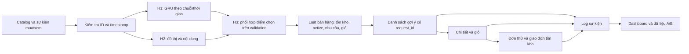

# Kịch bản thí điểm: gợi ý sản phẩm cho website bán mỹ phẩm

## Bài toán và người sử dụng

**Beauty Studio là tên cửa hàng minh họa**, không phải doanh nghiệp đối tác đã xác nhận. Báo cáo được cung cấp nêu thương mại điện tử/mỹ phẩm và hai hướng nghiên cứu; chưa có đề cương H3 độc lập, tên doanh nghiệp, hệ thống POS/CRM hoặc tiêu chí nghiệm thu từ đối tác. Kịch bản dưới đây là đề xuất để trình bày và chạy thử, cần đối chiếu khi có yêu cầu chính thức.

Vấn đề nghiệp vụ: khách mới khó tìm sản phẩm trong danh mục; khách có lịch sử chưa được ưu tiên sản phẩm phù hợp; đề xuất có thể dẫn đến hàng hết hoặc ngừng bán; cửa hàng thiếu dữ liệu nối từ đề xuất đến hành động mua.

| Vai trò | Điểm sử dụng | Công việc | Bằng chứng có trong demo |
|---|---|---|---|
| Khách mua hàng | Trang danh sách sản phẩm | Chọn nhu cầu, xem gợi ý, xem chi tiết, thêm giỏ | Danh sách còn hàng, lý do gợi ý và sự kiện có request_id |
| Nhân viên vận hành | Màn hình Điều hành | Nhập snapshot mã hàng/giá/tồn kho/trạng thái bán | CSV được kiểm tra; SKU ngoài snapshot tắt bán |
| Quản lý kinh doanh | Dashboard hành trình | Theo dõi gợi ý → click → giỏ → đơn thử; kiểm tra nhóm A/B | Log thật từ demo, không điền sẵn KPI kinh doanh |
| Kỹ thuật/dữ liệu | Adapter/Pipeline | Ghép ID, quản lý phiên bản và kết nối hệ thống nguồn | Mã xử lý độc lập trong src/business.py, kiểm thử giao dịch và dữ liệu |

## Một hành trình có thể kiểm chứng ngay

1. Vào **Cửa hàng trải nghiệm**. Chọn khách mới và một sản phẩm quan tâm, hoặc chọn hồ sơ lịch sử ẩn danh. Khách mới chưa chọn nhu cầu dùng popularity fallback.
2. Hệ thống lấy điểm theo tuyến phục vụ: hồ sơ dùng điểm đã tính trước; nhu cầu mới dùng tương đồng nội dung. H1/GNN chưa được huấn luyện online khi bấm nút.
3. Lớp nghiệp vụ loại SKU hết hàng/ngừng bán, SKU trong giỏ, sản phẩm làm hạt giống và lịch sử đã biết; lọc nhóm nhu cầu rồi đa dạng hóa top K.
4. Một request_id liên kết các SKU đề xuất với sự kiện impression. Bấm chi tiết hoặc thêm giỏ ghi click; thêm giỏ ghi cart. Một hành động lặp cùng request/SKU được khử trùng.
5. Tạo **đơn thử nghiệm**, không có thanh toán. Giao dịch SQLite kiểm tra lại trạng thái/giá/tồn kho, ghi đơn và trừ tồn kho cùng lúc. Thiếu một SKU thì hủy toàn bộ; cùng checkout_key không tạo đơn/trừ kho lần hai.
6. Mở **Điều hành cửa hàng → Đối chiếu đơn** để xem dòng hàng và đơn; đối chiếu **Danh mục & tồn kho**. Xem phễu và xuất log có request_id ở **Hành trình & A/B**.

## H1/H2/H3 nằm ở đâu?



Validation hiện chọn graph weight = 0 và H1 weight = 0, nên kết quả H2/H3 trùng content baseline. Đây là bằng chứng **chưa có lợi ích tăng thêm từ mô hình lai** trong thiết lập hiện tại. Không giấu kết quả này bằng cách gắn tên H3 vào mọi hành vi hoặc coi giá/tồn kho minh họa là dữ liệu doanh nghiệp.

## Dữ liệu và hợp đồng tích hợp

| Tập dữ liệu | Trường tối thiểu | Hệ thống nguồn trong doanh nghiệp | Adapter hiện có |
|---|---|---|---|
| Catalog | item_id, title, description, category, published_at | PIM/CMS | Catalog artifact Amazon; chưa hỗ trợ SKU mới ngoài mapping |
| Giá và tồn kho | item_id, stock, price, active, updated_at | ERP/POS/kho | CSV snapshot với item_id,stock,price,active |
| Hành vi | event_id, anonymous_customer_id, item_id, event_type, timestamp UTC | Website/app/CRM theo quyền dữ liệu | Log SQLite trong demo, visitor là mã phiên ngẫu nhiên |
| Lượt gợi ý | request_id, model_version/route, variant, item_id, position, timestamp | Dịch vụ gợi ý | request_id, route, variant và item_id đã có; chưa có log viewability/vị trí ngoài màn hình |
| Đơn | order_id, item_id, quantity, accepted_price, request_id | OMS/thanh toán | Đơn mô phỏng + order_items; attribution qua request trong sự kiện purchase |

CSV nhập kho là **snapshot**, không phải delta. Tệp thiếu mã nào sẽ tắt bán mã đó. Chỉ nhận SKU có trong catalog, stock và price nguyên không âm, active 0/1, giá hàng active > 0. Dữ liệu không hợp lệ bị từ chối trước khi đổi snapshot.

Ví dụ (thay bằng mã SKU có trong catalog):

```csv
item_id,stock,price,active
B00WAAIRPS,12,199000,1
```

Giá mặc định là giá sinh để minh họa, không phải giá Amazon hoặc báo giá cửa hàng. Phân nhóm từ từ khóa tiêu đề chưa phải taxonomy được doanh nghiệp duyệt. Ảnh vector là minh họa nhóm, không phải ảnh sản phẩm thật.

## Chỉ số và cách đọc

- Impression: SKU được đưa vào danh sách đã render; chưa đo viewability trong viewport.
- CTR: số click khử trùng / số impression, trong cùng variant. Click gồm mở chi tiết hoặc bấm thêm giỏ.
- Chuyển đổi phiên demo: số visitor có purchase / số visitor nhận impression trong variant; đây là **đơn mô phỏng**, không phải giao dịch thanh toán thật.
- Giá trị đơn mô phỏng: tổng accepted_price × quantity của orders đã tạo; không gọi là doanh thu doanh nghiệp.
- p95 xếp hạng: thời gian tra điểm + lọc + xếp lại trên máy chủ; không bao gồm mạng, render UI hay suy luận lại GRU/GNN.

A/B tắt mặc định. Khi bật, nhóm ổn định theo hash visitor: control dùng popularity, treatment dùng tuyến cá nhân hóa. Chỉ request tiếp theo nhận chế độ mới. Muốn thử A/B thật phải gán theo tài khoản/định danh phù hợp, kiểm tra cỡ mẫu, bot, thời gian, exposure và nối đơn thanh toán thật; số liệu demo không đủ để suy ra ưu thế thống kê.

## Tiêu chí thí điểm và nghiệm thu

| Giai đoạn | Điều kiện vào | Cần kiểm tra | Điều kiện đi tiếp |
|---|---|---|---|
| Chuẩn hóa dữ liệu | Có quyền dữ liệu và hệ thống nguồn | ID khớp, timestamp UTC, ngày xuất bản catalog, trạng thái SKU | Bộ dữ liệu được đối tác xác nhận và có log chất lượng |
| Kiểm chứng offline | Split thời gian xác minh, baseline chung | Recall/NDCG, warm/cold, full catalog, nhiều seed, latency/bộ nhớ | Chọn model theo validation, test giữ lại để báo cáo |
| Shadow | Adapter dữ liệu thật, DB bền vững, quyền truy cập | Không trả hàng ngừng bán/hết; đo p95 và fallback | Đạt SLA/guardrail được chốt trước; không tác động khách hàng |
| A/B giới hạn | Traffic đủ, phân nhóm và attribution đã kiểm tra | KPI chính, MDE, power/cỡ mẫu; guardrail tồn kho, lỗi, hoàn trả | Khoảng tin cậy và ý nghĩa thực tiễn đạt ngưỡng đã đồng ý |
| Rollout | Có người vận hành và phương án khôi phục | Giám sát drift, sự kiện trễ, dữ liệu trống, phiên bản | Có rollback, runbook và trách nhiệm xử lý sự cố |

Không có ngưỡng tăng trưởng doanh thu hay SLA được doanh nghiệp phê duyệt trong tài liệu hiện tại. Không tự ghi các ngưỡng đó thành kết quả đã đạt.

## Ranh giới kỹ thuật của phiên bản này

- SQLite chạy trong **một instance**; Render Free không có lưu trữ bền vững, log/đơn/tồn kho nhập có thể mất khi restart/redeploy. Trước pilot thật chuyển sang PostgreSQL hoặc dịch vụ DB bền vững.
- Có mật khẩu vận hành tùy chọn qua biến `RETAIL_ADMIN_PASSWORD`; nếu không cấu hình, màn hình quản lý mở để trình diễn. Cần SSO/RBAC, audit quyền sửa và session security cho triển khai thật. Không nhập thông tin khách hàng thật trong bản public demo.
- Module nghiệp vụ là adapter chạy nội bộ Streamlit, **chưa có REST API thương mại**. Khi nối website/POS, bọc cùng nghiệp vụ thành API có xác thực, timeout, rate limit, contract test và idempotency.
- Chưa nối ERP/POS/CRM/OMS, payment, vận chuyển, thuế, voucher hay hoàn trả. “Tạo đơn thử nghiệm” không tạo đơn trong hệ thống doanh nghiệp.
- Không có tác vụ tái huấn luyện online. Dữ liệu thời gian gốc, metadata đầy đủ, nhiều seed và lợi ích thực tế của mô hình vẫn là công việc cần làm trước production.
