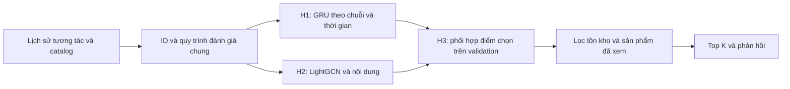

# Kiểm tra tính liên kết và chất lượng nghiên cứu

## Phạm vi tài liệu

Báo cáo PDF nêu **hai hướng**, không phải ba. Trong H1, M1/M2/M3 là ba biến thể GRU, không phải ba hướng độc lập. Đề xuất H3 là hướng tích hợp H1 + H2 để có một sản phẩm phục vụ thống nhất. Nếu đề cương chính thức quy định H3 khác, cần đối chiếu thêm đề cương đó; chưa có tên doanh nghiệp hoặc yêu cầu nghiệm thu cụ thể trong tài liệu đã cung cấp.

## Những điểm chưa khớp

| Vấn đề | Bằng chứng | Cách xử lý trong demo |
|---|---|---|
| Quy mô dữ liệu | Train gốc 2.712, validation 646, test 646 dòng, 646 người; 617 là số item test, không phải catalog | Xuất kiểm toán với thống kê tính trực tiếp từ file |
| Ánh xạ/checkpoint khác quy mô | user2idx 7.751, item2idx 18.162; metadata 2.934 item | Xây ánh xạ mới và huấn luyện lại, không ghép checkpoint cũ một cách suy đoán |
| Cold-item áp đảo | 539/646 mục tiêu test không nằm trong train gốc | Báo cáo warm/cold riêng; phân loại lại theo train thực dùng |
| Timestamp không giống Unix hợp lệ | Giá trị khoảng 10.912–16.812; 222 user train cuối trùng validation, 186 user validation trùng test | Không gọi là ngày; dùng khoảng cách tương đối, bỏ train timestamp >= validation của user, chỉ lấy lịch sử trước mục tiêu |
| Văn bản bị mất cấu trúc | Description/features trong tệp đã xử lý chứa `[List]` | Chỉ mã hóa tiêu đề sản phẩm từ metadata, không dùng review sau mua |
| Thiếu artifact MiniLM | Không có item_embeddings.npy trong ZIP | Dùng TF-IDF/SVD, công bố đúng bộ mã hóa |
| Gọi tên chỉ số trong PDF | NDCG được mô tả như độ đa dạng | Sửa diễn giải: NDCG đo chất lượng thứ hạng; Coverage đo độ phủ danh mục |
| So sánh kết quả cũ | PDF và CSV không cùng quy mô; có bảng gắn Users/Cold Targets = 7.751 | Không sao chép kết quả cũ thành kết quả xác nhận |

Notebook H2 dùng phép cộng láng giềng rồi chia theo chỉ số tầng, không phải chuẩn hóa bậc nút LightGCN chuẩn. Triển khai mới dùng D^(-1/2) A D^(-1/2), chỉ tạo cạnh từ train được phép học.

## Sợi dây liên kết

H1 phục vụ thay đổi sở thích; H2 bổ sung quan hệ cộng tác và nội dung cho item ít tương tác; H3 kiểm tra xem các tín hiệu có bổ sung nhau thật không. Nếu validation chọn bỏ H1 hoặc graph, kết luận đúng là chưa có bằng chứng lợi ích tăng thêm. Không được gọi kết quả đó là cải thiện của mô hình lai.

## Cần làm trước khi bảo vệ hoặc triển khai thật

1. Lấy timestamp gốc có đơn vị và ngày công bố catalog; dựng lại split toàn cục theo thời gian, loại tương tác trùng.
2. Chuẩn hóa metadata có mô tả thật; so sánh TF-IDF với MiniLM trên cùng catalog và cùng người dùng. MiniLM là sentence encoder, không đồng nghĩa mô hình ngôn ngữ sinh.
3. Chạy nhiều seed, ablation graph-only/text-only/GRU/hybrid và bootstrap chênh lệch theo cặp. CI đang có chỉ phản ánh bootstrap người dùng của một seed.
4. So sánh full-catalog và warm/cold, latency, bộ nhớ, độ phủ; không chọn mô hình bằng test.
5. Thực hiện A/B tại doanh nghiệp để xác minh hiệu quả kinh doanh; offline không chứng minh tăng doanh thu.
